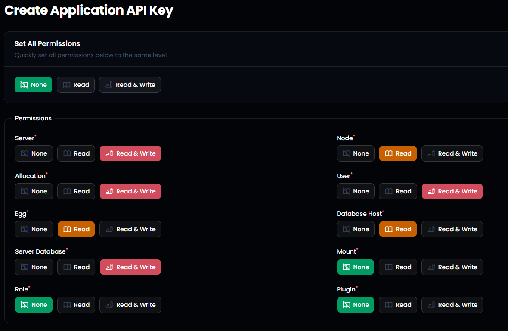

<h1 align="center">👋 Welcome to Pelican Discord Bot</h1>

<p align="center">
A powerful Discord bot to manage your Pelican panel.
</p>

---

## 📚 Table of Contents
- 📖 Description
- ⚡ Features
- ⚙️ Configuration
- 🚀 Getting Started
- 🔗 Links
- 📝 License

---

## 📖 Description
Pelican Discord Bot allows you to manage your **Pelican panel directly from Discord**.

### 🖥️ Server Management
- ➕ Create servers
- ❌ Delete servers
- 📋 View all servers
- 🔍 Server details
- ⛔ Suspend / Unsuspend servers

### 👤 User Management
- ➕ Create users (email or PDF password delivery)
- ❌ Delete users
- 📋 View users
- 🔍 User details
- 🔗 Link / Unlink Discord accounts

### 📊 Monitoring
- 📡 Monitor bot status
- ➕ Add monitored bots
- ❌ Remove monitored bots
- 📋 View monitoring dashboard

---

## ⚡ Features

### 🤖 Discord Interactions
- Slash commands
- Autocomplete (users, servers)
- Buttons & select menus
- Modern Discord UI components (Embed V2 style)

### 🔐 Flexible API System
- 🌐 Global API key (application-level actions)
- 👤 User API keys (personalized actions per user)

---

## ⚙️ Configuration
### 1. Setup bot
Go to the Discord Developer Portal and create a new application:

🔗 https://discord.com/developers/applications

> 🚨 **IMPORTANT**  
> If you don't add a profile picture to your bot, some commands will not work correctly.

> 🚨 **IMPORTANT 2**  
> You need to add the following Intents to your bot:
>- Presence Intent
> - Server Members Intent

### 2. Config file
Rename config.example.json to config.json

```json
{
  "serverIdDeploySlash": "Id of the server where the slash commands will be deployed",
  "database": {
    "client": "mysql",
    "connection": {
      "host": "Host of the database",
      "port": "3306",
      "user": "User of the database",
      "password": "Password of the database",
      "database": "Name of the database",
      "charset": "utf8mb4"
    },
    "pool": {
      "min": 0,
      "max": 7
    }
  },
  "monitoringBot": {
    "channelId": "Channel where the bot will send the monitoring messages of the status of the bot",
    "roleId": "Role to ping when the bot is down"
  },
  "pterodactyl": {
    "url": "URL of the panel : https://panel.xxx.com",
    "apiKeyApp": "App API key on pterodactyl : ptla_XXXXXXXXXXXXXXXXXXXXXXXXXXXXXXX",
    "mailSetup": "If the mail system is enabled on the panel : true or false",
    "host": "SFTP of the pterodactyl : xxx.com",
    "port": "Port of the pterodactyl : 2022"
  }
}
```
### 3. Environment file
Rename .env.example to .env

```
TOKEN=YOUR_BOT_TOKEN
DEPLOY_SLASH=true : If you want to deploy the slash commands or not (true or false)
```
### 4. API Permissions
Make sure your API key has the correct permissions:


---

## 🚀 Getting Started
▶️ Invite the bot to your server with the following link:

🔗 https://discord.com/oauth2/authorize?client_id=YOUR_BOT_ID&permissions=8

> 🚨 **IMPORTANT**  
> Replace YOUR_BOT_ID with the ID of your bot.

```md id="i3"
# Install dependencies
npm install

# Start the bot
node main.js
```

---

## 🔗 Links
- If you have any questions, don't hesitate to join the Discord server:

    💬 Discord Support: https://discord.gg/Dwn5Nc6WgR 


- Our website where you can find all our bots:

    🌐 Website: https://botmarket.ovh

---

## 📝 License
This project is licensed under the MIT License

